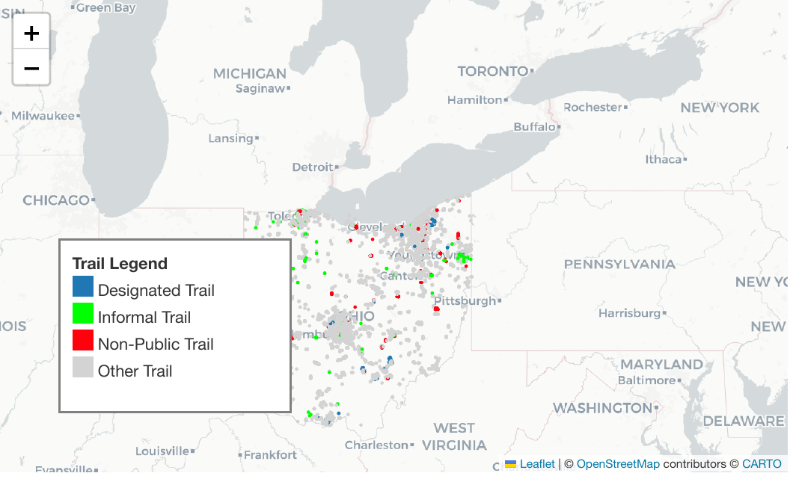

# Python Data Projects

Two data analysis projects I completed in Python for a data course at Kent State University (Fall 2024).

| Project | Question | Tools |
|---|---|---|
| [**Tagging Unmarked Ohio Trails**](ohio-trails/) | Can OpenStreetMap data tell hikers which Ohio trails are official, informal or off-limits? | GeoPandas, Folium, Overpass API, ArcGIS REST |
| [**What Makes TikTok Sounds Popular?**](spotify-tiktok-sounds/) | Do viral TikTok songs share musical traits like key, tempo or time signature? | Spotify Web API, pandas, Matplotlib |



## Run the notebooks

```bash
pip install -r requirements.txt
jupyter lab
```

Each project's README explains the data it needs. The source data files are too large to include here.
