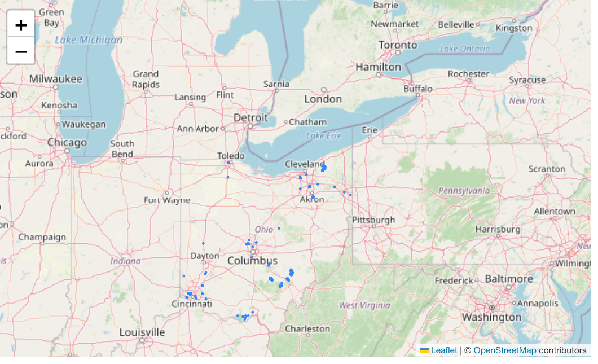
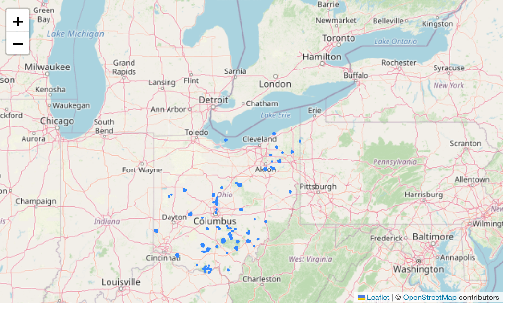
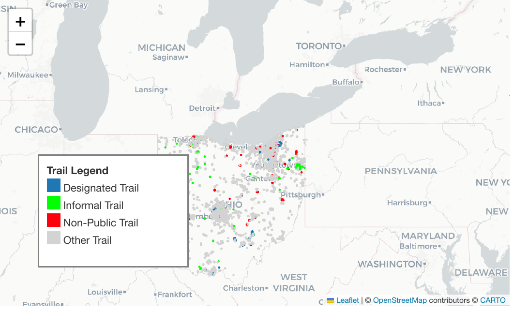

# Tagging Unmarked Ohio Trails Using Data

Hiking apps like AllTrails build their maps from OpenStreetMap (OSM), an open, community-edited map. OSM often doesn't distinguish official, maintained trails from unofficial "social" trails or closed ones, so apps can show them all the same way. That sends hikers onto trails that can put them and wildlife at risk. OSM's Trail Stewardship Initiative is working to fix this by getting trails tagged correctly.

In this project, I explored how well Ohio's trails are currently tagged in OSM, and how that data could be sorted so apps show hikers the trails they can trust.

**Full report:** [Notebook](ohio-trails-report.ipynb) · [PDF](ohio-trails-report.pdf). The notebook is large, so GitHub may not preview it. The PDF always works.

## Process

**1. Gathered two data sets**

- **OSM:** every path tagged `highway=path` in Ohio, pulled with the Overpass API.
- **Ohio Department of Natural Resources (ODNR):** official state trail data from its ArcGIS REST service, used as the reference for what official trails should look like.

**2. Filtered the OSM data for official trails.** OSM has no single tag for "official," so I combined the tags that suggest it: a named `operator`, an `official_name`, a `ref` number, `informal=no`, and `access=yes` or `permissive`.

**3. Compared against official data.** The filtered OSM trails were sparse but followed the same pattern as ODNR's official trails.

| Filtered OSM trails | Official ODNR trails |
|---|---|
|  |  |

**4. Sorted and color-coded every trail.** Following the Trail Stewardship Initiative's terms, I mapped every Ohio path into four categories with Folium:

- **Designated** (blue): has an operator, official name, ref number, `informal=no`, or public access
- **Informal** (green): tagged `informal=yes`, so used by people but not intended by the park
- **Non-public** (red): tagged `access=private` or `no`
- **Other** (gray): only tagged `highway=path`, likely not part of a maintained park system

## Findings

Most Ohio paths in OSM fall into "Other." They exist on the map but carry no information about whether they're official. Closing that gap will take manual re-tagging. The categories above also give trail apps a workable structure for deciding which OSM trails to recommend.

## Data

The GeoJSON files are too large for this repo. To recreate them:

- **`export.geojson`:** run `nwr["highway"="path"]({{geocodeArea:Ohio}}); out geom;` at [overpass-turbo.eu](https://overpass-turbo.eu) and export as GeoJSON.
- **`query.geojson`:** query ODNR's [Trails service](https://gis2.ohiodnr.gov/arcgis/rest/services/OIT_Services/Trails_WayPoints_POI/MapServer/2) with `Where: 1=1`, `Out Fields: *`, `Format: GeoJSON`.

Put both files in this folder before running the notebook.

## Built with

Python, pandas, GeoPandas, Folium, JupyterLab, Overpass API, ArcGIS REST API

Map data © OpenStreetMap contributors.
