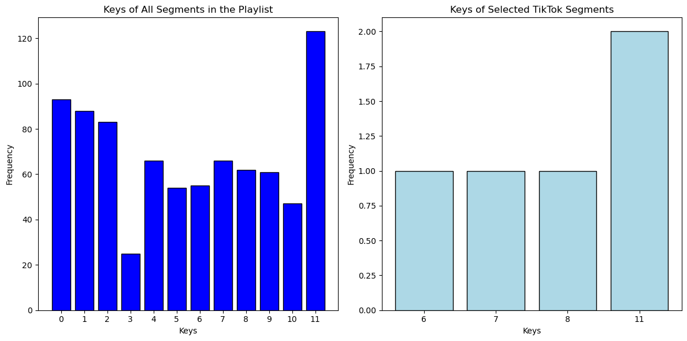
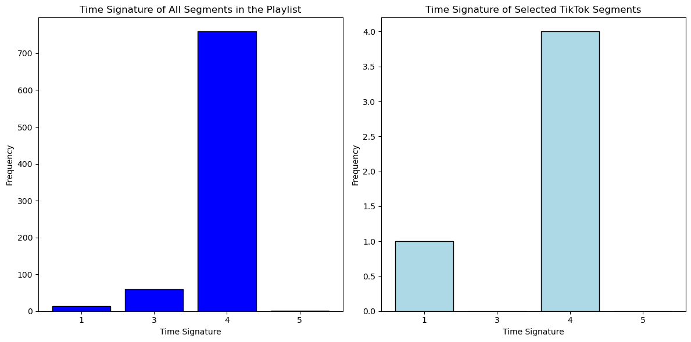
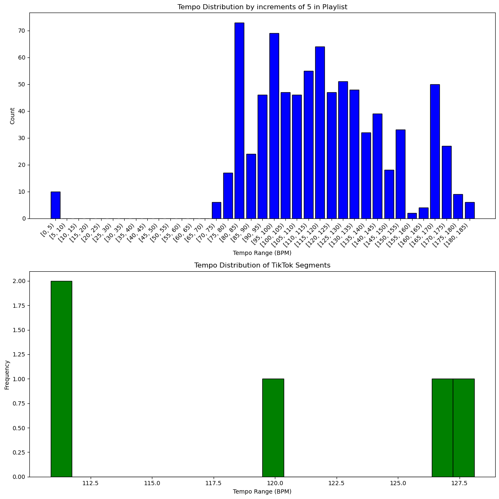

# What Makes TikTok Sounds Popular?

TikTok has changed how songs become hits. Artists and labels now aim for a viral "sound," a short clip other creators use in their videos. I used the Spotify Web API to look for musical traits that popular TikTok songs share.

**Full report:** [Notebook](tiktok-sounds-analysis.ipynb)

## Process

1. **Pulled a playlist** of the top TikTok songs from 2019–2024 ("Best Tik Tok Songs 2019-2024" by The Vibe Guide) through the Spotify API.
2. **Ran Spotify's audio analysis** on every track, which splits each song into sections with their own key, tempo and time signature.
3. **Hand-picked the viral clips.** I listened to the five most popular tracks and identified the sections that became TikTok sounds, to compare against the playlist as a whole.
4. **Charted the patterns** in key, time signature and tempo.

## Findings

Popular sections leaned toward the key of B, 4/4 time and tempos between about 110 and 130 BPM. 4/4 is the most common time signature in music overall, so a fair test would compare against a control set of non-viral songs. Using TikTok's own data to find the viral clips would also be more reliable than picking them by ear.

## Running it

The notebook reads Spotify API credentials from a local `ClientID.txt` file, which is not included. Note that Spotify has since restricted its audio analysis endpoints for new apps, so the analysis may not run with a new developer account.

## Built with

Python, pandas, Matplotlib, Spotify Web API, JupyterLab
